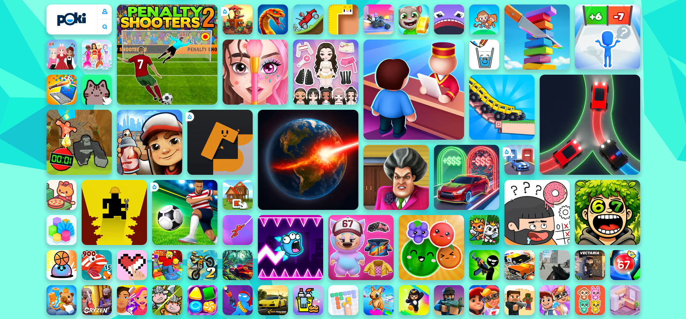
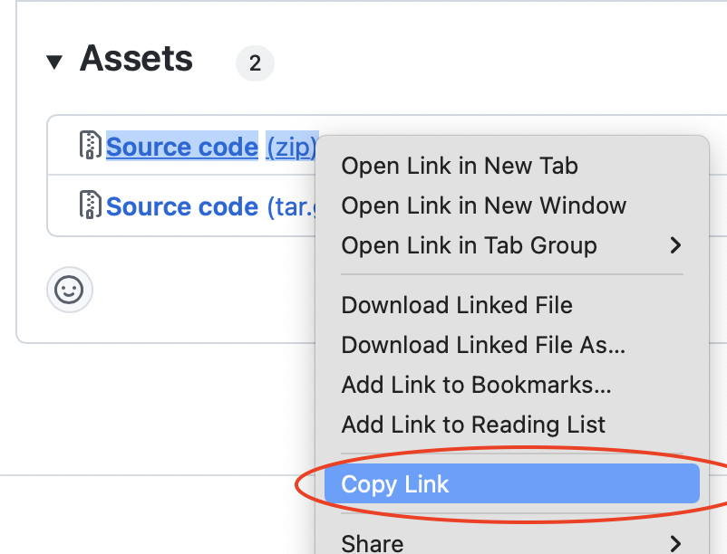
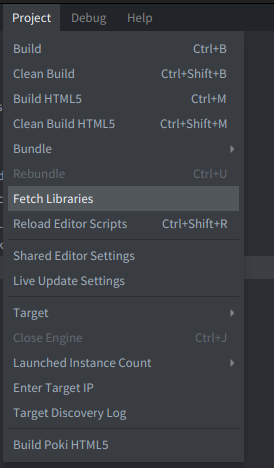
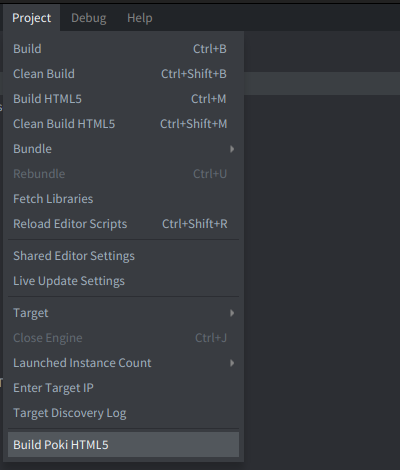
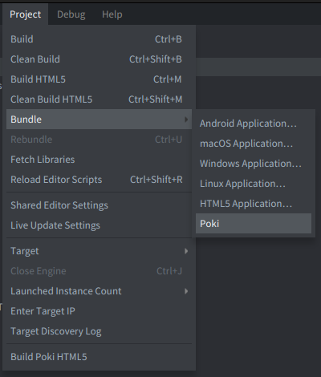

# Defold Poki SDK extension API documentation

This [Defold native extension](https://defold.com/manuals/extensions/) provides access to the Poki SDK from Lua and supplies Poki-specific HTML5 loading, build, and bundle integration. [Poki](https://poki.com) is an online playground where players and game developers come together to play and create. The games on Poki are created by a diverse global game developer community. Got a game? Submit it via [developers.poki.com](https://developers.poki.com).



::: important
Defold 1.13.0 and newer versions use `wasm-web` only. Defold 1.13.0 removed `js-web`; legacy asm.js builds are not supported.
:::

## Best practices

Before you dive in and start integrating the Poki SDK in your game, it is recommended to learn some of the [best practices when building for the web](best-practices) that you can check below. We also created a sample game for Poki to demonstrate these best practices.

## Sample Game

[Defold Sample Poki Game](https://github.com/defold/sample-poki) is a complete, playable 3D space shooter called Starbreaker that serves as a starting point for building games for Poki. It demonstrates Poki SDK integration, commercial and rewarded ads, pause and focus handling, audio, saves, input across desktop and mobile devices, and Live Update. The project also includes in-game Poki Dev Tips with practical guidance for developing and testing web games for Poki.

Open the guide with the Poki button or **P** while playing to see tips for the current screen. Read the [tip collection](https://github.com/defold/sample-poki/blob/master/learn/tips.lua) alongside the sample implementation. Some tips refer to the sample's service wrappers; use the public extension calls and callback constants below when integrating the SDK directly.


### Onboarding players

Bring new players into a part of the game that is instantly playable and fun with a clear goal and a visual control hint to get their attention as fast as possible. Introduce additional controls only if they are needed, preferably gradually. Keep the first phase of the game easy to learn, and show instructions for the current input method. Test the game's first introductory part on a phone and on a desktop computer with a keyboard and mouse.

Keep text to a minimum. It's always better to show than to tell, especially when it comes to explaining the game's mechanics. As far as possible for your kind of game, reduce the number of tutorial pop-ups to a minimum and keep the tutorial as part of the introductory gameplay session to keep players interested. For controls, show icons or images representing each action and its corresponding key, button, or gesture. Images, icons and pictograms are universal.

#### Localization

Localize all required text and instructions into as many languages as possible. Poki players are from different countries and some people may not understand the text, so it's important to keep the game readable and understandable even without understanding the text. For languages that require specific new fonts, load the resources for them asynchronously when needed using Defold's [Live Update](https://defold.com/manuals/live-update/).

#### Initial download size and loading screen

You have only a few seconds to capture a player’s interest, and loading takes up part of that time. Measure loading with the browser cache disabled and try to reduce the game's size and thus loading time to a minimum. Include only the assets needed for the first interaction in the initial download. Consider Live Update for later content that is not needed for the first introductory part of the game, with a retry or fallback if a download of deferred assets fails. It is good to put in Live Update packages stuff like audio files, fonts or textures and models not needed initially. Deferring downloading of later stages of the game might also be a good idea.

#### Poki Events

Send `poki_sdk.gameplay_start()` on the first meaningful input that begins actual gameplay, rather than during initialization or when displaying instructions and still not being "in the game", as sometimes your game might start in a paused mode. See [Poki's onboarding guide](https://developers.poki.com/guide/easy-access) for more design guidance.

### Retention loops

Give useful result feedback to your players on what happened, whether they win or lose. Make `Continue` or `Retry` the primary action, with a clearly visible button that is easy to click or tap and supports keyboard or gamepad input where appropriate. Let players quickly retry and apply what they learned. Introduce reachable goals and upgrades without making players navigate several menus between attempts.

#### Progress

Save progress, settings, and completed tutorial steps, but even if browser storage is unavailable, still keep the current session playable. Test both a fresh visit (you can test this in Incognito Mode in your browser) and a return visit - returning players should keep their progress and avoid repeating onboarding they have already completed. Some players skip tutorials, so make crucial information available elsewhere, such as on the Pause or Settings screen. At least keeping the main controls there is a good idea.

#### Engagement tracking

Track attempts with the progress events. Compare where players stop with playtest recordings before adding more content or changing difficulty. See [Poki's engagement guide](https://developers.poki.com/guide/engagement) for more details.

### Monetization placement

Choose ad placements that fit naturally into the game flow. A commercial break usually occurs during an intentional return to gameplay after a natural stop, e.g. completing the level, achieving some progress, etc.

Rewarded offers should be well described or presented and give players in return a useful, preferably optional benefit, such as a revive or a cosmetic unlock. Keep the standard action for continuing the game clear and available. See Step 4 below for more details.

Review the [Poki monetization tips](https://developers.poki.com/guide/monetization) and [ad integration requirements](https://developers.poki.com/guide/requirements-quality#advertisement-integration) before designing offer buttons. Follow Steps 3-5 below for callback handling, input, and pause behavior.


## Getting started

### Step 1 - Installation

To use Poki SDK in your Defold project, add a version of the Poki SDK extension to your `game.project` dependencies:

```text
https://github.com/defold/extension-poki-sdk/archive/refs/tags/<version>.zip
```

Replace `<version>` with the version you want to use, or copy the ZIP URL from the list of available [Releases](https://github.com/defold/extension-poki-sdk/releases).



Select `Project->Fetch Libraries` once you have added the version to `game.project` to download the version and make it available in your project.



### Poki editor commands

The extension adds two commands to the Defold editor:

- **Project → Build Poki HTML5** builds a debug `wasm-web` bundle and opens it in the Poki Inspector.



Keep the Defold editor open while testing: it serves the local HTML5 build to the browser.

The [Poki Inspector](https://inspector.poki.dev/) helps you verify the integration before uploading the game:

- inspect SDK, gameplay, ad, and `measure()` activity in the Event Log, together with detected errors and warnings;
- work through the QA Modules checklist and review the total loading time and initial download size;
- perform Scaling Tests (see below);
- run Inspector experiments such as Mute, Time, Assets, and Dark Mode;
- generate a QR code or URL to open the local build on a mobile device while continuing to inspect its SDK events in the desktop browser.

See the [Poki Inspector guide](https://sdk.poki.com/poki-inspector) for the complete testing workflow.


Use Scaling Tests to try different resolutions, aspect ratios, and mobile-device presets, including rotating supported devices to check portrait and landscape behavior—see the [Defold GUI layouts manual](https://defold.com/manuals/gui-layouts/) for building adaptive interfaces.


- **Project → Bundle → Poki** creates a `wasm-web` bundle, packages it as `poki.zip`, and opens the Poki upload flow.



### Step 2 - Implement the gameplay events

Use the `poki_sdk.gameplay_start()` event to describe when users are playing your game (e.g. on first user interaction and unpause), so when the player's first input begins gameplay, and whenever active gameplay resumes after an interruption. Do not send it on load or simply because a menu (pause) is closed.

Use the `poki_sdk.gameplay_stop()` event when gameplay stops (e.g. level finish, game over, pause, focus loss, quit to menu). Freeze the game world as appropriate for your genre; sending an SDK event does not pause the Defold simulation.

Send events on state transitions, with no two starts or two stops in succession. Menus, result screens, and non-interactive instructions should not count as active play. An interactive tutorial can count as gameplay when the player is actually playing.

```lua
-- first level loads, player clicks anywhere
poki_sdk.gameplay_start()
-- player is playing
-- player loses round
poki_sdk.gameplay_stop()
-- game over screen pops up
```

### Step 3 - Implement commercial breaks

Commercial breaks are opportunities to display video ads when the player chooses Continue, Retry, or Resume after gameplay has stopped. Request the break on the way back into play, rather than when opening a pause menu or displaying a result screen. Skip the first entry into gameplay and return directly from a rewarded break without immediately requesting a commercial break.

The regular sequence is `gameplay_stop()` → player chooses to continue → `commercial_break()` → final callback → resume gameplay and send `gameplay_start()`. You have to keep the gameplay paused until the final callback, even when no ad is displayed. See [Poki's SDK event sequences](https://developers.poki.com/guide/sdk-overview#order-of-events).

The Lua callback represents Poki's `commercialBreak(startCallback).then(...)` flow: it receives `COMMERCIAL_BREAK_START` if Poki invokes the start callback, then `COMMERCIAL_BREAK_SUCCESS` when the promise resolves. A break opportunity does not necessarily display an ad.

```lua
-- The player chooses Continue/Retry/Resume after gameplay has stopped.
-- Keep the world paused and block repeated requests until the final callback.
poki_sdk.commercial_break(function(self, status)
  if status == poki_sdk.COMMERCIAL_BREAK_START then
    print("Commercial break started")
  elseif status == poki_sdk.COMMERCIAL_BREAK_SUCCESS then
    print("Commercial break finished or did not happen")
    -- Restore input and resume gameplay here.
    -- Send gameplay_start() when active gameplay actually resumes.
  end
end)
```

::: important
Not every `poki_sdk.commercial_break()` will trigger an ad. Poki’s system will determine when a user is ready for another ad. Thus, you do not need to add an internal ad timer or a minimum level threshold to manage frequency. Feel free to signal eligible opportunities at natural moments and let Poki control ad frequency.
:::


### Step 4 - Implement rewarded breaks

Rewarded breaks allow for a user to choose to watch a rewarded video ad in exchange for a certain benefit in the game (e.g. more coins, etc.). When using `poki_sdk.rewarded_break()`, please make it clear to the player beforehand that they’re about to watch an ad.

Show the standard action to continue playing the game (`Continue`/`Retry`) alongside the rewarded option, with at least equal prominence. It's good to keep the standard action as the default for the usual keyboard or gamepad confirmation input (e.g. `Space`), and use a separate intentional action for the rewarded offer. Rewarded buttons must include a prominent video icon and must **not** be green. See the [complete button hierarchy requirements](https://developers.poki.com/guide/requirements-quality#advertisement-integration).

The Lua callback maps Poki's `rewardedBreak({ size, onStart }).then(success => ...)` flow to statuses. It receives `REWARDED_BREAK_START` if Poki invokes `onStart`, followed by `REWARDED_BREAK_SUCCESS` when the promise resolves to `true` or `REWARDED_BREAK_ERROR` when it resolves to `false`.

Grant the advertised reward exactly and only once, on `REWARDED_BREAK_SUCCESS`. On `REWARDED_BREAK_ERROR`, keep the normal way to get back to the gameplay available without granting the reward. Do not use `is_ad_blocked()` to decide whether to grant it, Poki handles it.

```lua
-- gameplay stops
poki_sdk.rewarded_break(function(self, status)
  if status == poki_sdk.REWARDED_BREAK_ERROR then
    print("Rewarded break resolved without a reward")
  elseif status == poki_sdk.REWARDED_BREAK_START then
    print("Rewarded break started")
  elseif status == poki_sdk.REWARDED_BREAK_SUCCESS then
    print("Rewarded break success")
  end
end)
```

You can also request a reward size of `"small"`, `"medium"`, or `"large"`. Omitting it defaults to `"small"`:

```lua
poki_sdk.rewarded_break("medium", function(self, status)
  if status == poki_sdk.REWARDED_BREAK_SUCCESS then
    print("Grant the medium reward")
  end
end)
```

Learn more about rewarded ads in the [Poki monetization guide](https://developers.poki.com/guide/monetization).

::: sidenote
Calling `poki_sdk.rewarded_break()` affects the timing of `poki_sdk.commercial_break()` - When a user interacts with a rewarded break, our system’s ad timer is reset to ensure the user does not immediately see another ad.
:::


### Step 5 - Pause game and disable input during ads

Make sure that the game is paused and controls are disabled during `commercial_break` and `rewarded_break`, so that the game doesn’t interfere with the ad. Block keyboard, mouse, touch, and gamepad input throughout the request, and use one shared pending state to prevent commercial and rewarded requests from overlapping. Do not wait for a `*_BREAK_START` status to lock the UI.

Do not send gameplay or `measure()` events while an ad is playing. On every final status, clear the pending state and return to the appropriate screen. Resume gameplay only if the player is returning directly to the game. Preferably, return to a paused state or another screen that requires meaningful player input before gameplay resumes. For example, unlocking a skin from a menu does not require a new gameplay-start event, but resuming gameplay after an ad may require one. Keep the script that owns the callback alive until the request finishes.

```lua
-- In the rewarded offer handler, after stopping any active gameplay:
if self.ad_busy then
  return
end

 -- Use the same guard for commercial requests:
self.ad_busy = true

-- Pause the world and block game input here before requesting the ad:

poki_sdk.rewarded_break(function(self, status)
  if status == poki_sdk.REWARDED_BREAK_START then
    print("Rewarded break started; keep game input blocked")
  elseif status == poki_sdk.REWARDED_BREAK_ERROR or status == poki_sdk.REWARDED_BREAK_SUCCESS then
    self.ad_busy = false
    if status == poki_sdk.REWARDED_BREAK_SUCCESS then
      -- Grant this request's reward exactly once here.
    end
    -- Restore the menu or prepare to resume play, depending on the offer.
    -- Restore input; send gameplay_start() only when gameplay resumes.
  end
end)
```

::: important

Beginning with Poki Extension 3.3.0, sound will be muted automatically when ADS are shown.

:::

If you store the player's settings regarding the sound - preserve the sound settings when restoring audio after a break or focus loss. Temporary sound muting during an ad should not change their saved preference.

### Step 6 - Implement custom events

Use `poki_sdk.measure(category, what, action)` to record meaningful checkpoints in a game. Parameters can be any strings. The Defold binding defaults omitted `what` and `action` to empty strings for compatibility, but this fallback is not the recommended event shape. Use custom strings for meaningful game events. Choose short, stable values that remain comparable across game versions:

- `category` is the broad group, such as `"level"`, `"button"`, `"rewarded"`, or `"cosmetic"`.
- `what` identifies the specific level, placement, button, item, or system.
- `action` describes what happened. Poki gives special reporting meaning to `start`, `complete`, `fail`, `visible`, and `interact`; custom action values are also accepted.

::: important
Commercial and rewarded ad playback and outcomes are tracked automatically through `poki_sdk.commercial_break()` and `poki_sdk.rewarded_break()`. Do not send `measure()` events for ad impressions, playback, completion, failure, or reward grant. Rewarded `visible` and `interact` events describe only the in-game offer UI.
:::

See [Poki's Game Events documentation](https://sdk.poki.com/game-events) for more patterns and reporting guidance.

Some good practices for events:

#### Progress events

Measure users' progress to get statistics on how players are doing in your game.
Use the same category and `what` value for an attempt. Send `start`, followed by either `complete` or `fail` - never both for the same attempt:

```lua
-- Tutorial attempt
poki_sdk.measure("level", "tutorial", "start")
poki_sdk.measure("level", "tutorial", "complete") -- or "fail"

-- Level attempt
poki_sdk.measure("level", "1", "start")
poki_sdk.measure("level", "1", "complete") -- or "fail"
```

#### Rewarded offer events

Measure statistics for rewarded ad offers—when these are visible to players and when players decide to use them.
Measure the in-game offer that leads to a rewarded video. Send `visible` when the offer becomes visible and `interact` when the player chooses it:

```lua
-- The treasure-chest offer is shown.
poki_sdk.measure("rewarded", "treasure-chest", "visible")

-- The player chooses the offer, immediately before requesting the ad.
poki_sdk.measure("rewarded", "treasure-chest", "interact")
poki_sdk.rewarded_break(function(self, status)
  if status == poki_sdk.REWARDED_BREAK_SUCCESS then
    -- Grant the treasure-chest reward.
  end
end)
```

The placement name should describe the offer, not the ad result. Use the same category and placement for both events so exposure and engagement can be compared.

#### UI Interaction events

Measure other key gameplay or UI elements that might help you shape your game to better suit players or help them navigate to desired places.
The same `visible` and `interact` pair can be applied to shops, buttons, upgrades, power-ups, and other UI:

```lua
-- The shop button becomes visible in the menu.
poki_sdk.measure("button", "shop", "visible")

-- The player opens the shop.
poki_sdk.measure("button", "shop", "interact")

-- The player sees and selects a shop item.
poki_sdk.measure("shop-item", "extra-coins", "visible")
poki_sdk.measure("shop-item", "extra-coins", "interact")
```

#### Meta-game or cosmetic upgrades events

Measure when players choose cosmetic upgrades or interact with meta-game features:

```lua
-- Count milestones and item-specific cosmetic unlocks.
poki_sdk.measure("cosmetic", "items", "unlock-2")
poki_sdk.measure("cosmetic", "hat", "unlocked")
```

#### Difficulty change events

Detect when players change the difficulty level if your game supports it, so that you know whether the available levels suit most players.

```lua
-- Measure difficulty changes
poki_sdk.measure("difficulty", "hard", "selected")
```

### Step 7 - Upload and test your game in Poki for Developers

Congrats, you’ve successfully implemented the Poki SDK! Now upload your game to the Poki Inspector and test it there.

Use a fresh save for the first session, then repeat with saved progress. Work through these paths and check the Event Log:

| Player journey | Check |
| --- | --- |
| First visit | Loading and control hints work on desktop and a mobile phone. First gameplay starts on player input without a commercial break. Game is started from scratch, progression is cleared. If you have any tutorial, welcome screen, or initial phase - it starts properly on a first visit. |
| First win or failure | The result explains what happened and next actions are available (`Continue` or `Retry`) and is easy to find and click (and eventually has a keyboard or button assigned). |
| Pause or switch browser tabs | Gameplay stops once. Returning to a real-time game does not resume into danger without player intent. |
| Continue, Retry, or Resume | At your designed points where a commercial opportunity is resolved, Poki can show an ad when available. Gameplay starts once when play resumes. |
| Rewarded offer | The reward matches the offer and is granted once on success. After an unsuccessful request you should still be able to get back to game. |
| Tap an offer repeatedly | Only one ad request is pending, game input is blocked during the break, and no gameplay or measurement events fire during ad playback. |
| Reload or disable browser storage | Saved progress and settings restore when available. After storage access failure you are still able to get back to the current session. |

Use [Poki playtests](https://developers.poki.com/guide/playtesting) to watch where new players hesitate or leave, alongside the events from Step 6. When you’re happy with the implementation, upload your game through Poki for Developers and send a review request. Contact Poki via Discord or developersupport@poki.com if you’re stuck.

When you’re happy with the implementation and will pass the required tests, send Poki a review request and they'll play the game. Feel free to contact Poki via Discord or developersupport@poki.com if you’re stuck.

## Advanced topics

### Safe calls in non-HTML5 builds

The Lua module is available only in HTML5 builds. When your project is also meant to be run on another platform, safeguard Poki extension calls with a small wrapper:

```lua
if html5 then
  poki_sdk.gameplay_start()
end
```

### Error handling

Do not collect Lua errors manually using `sys.set_error_handler()`. The SDK collects Lua errors and the engine's errors and warnings automatically.

### Deprecated ad-block compatibility

`poki_sdk.is_ad_blocked()` remains available for compatibility but is deprecated and always returns `false`. Do not use it for game logic.

### Editor API metadata

The extension includes `poki-sdk/api/poki-sdk.script_api`, which Defold uses for editor autocomplete and API documentation.

For VS Code users running Lua Language Server, `poki-sdk/api/lls-annotations.lua` provides equivalent Lua annotations. Add that file to the Lua workspace library only if the editor does not discover dependency annotations automatically.


### Shareable URLs & URL manipulation

#### Creating shareable urls and changing the Poki.com url

You can create a shareable url with the following function:

```lua
local params = {
  id = "myid",
  type = "mytype",
  score = 28
  -- ... any other param
}
poki_sdk.shareable_url(params, function(self, url)
  print(url)
  -- if run on e.g. https://poki.com/en/g/my-awesome-game it will return:
  -- https://poki.com/en/g/my-awesome-game?gdid=myid&gdtype=mytype&score=28
end)
-- read further to see how to fetch these params easily from within your game
```

#### Reading Poki.com url params

As you might have noticed in the previous topic, the `poki_sdk.shareable_url()` creates a url with parameters that are prefixed with gd. We have created a simple helper function that will easily allow you to read the params.

```lua
poki_sdk.get_url_param("<param name>")

-- example
local id = poki_sdk.get_url_param("id")
-- this will return either the gdid param set on poki.com or the id param on the current url
```

The extension returns the string supplied by `PokiSDK.getURLParam(key)`. If that JavaScript call returns `null` or `undefined`, the Defold bridge returns `nil`; Poki's documentation does not otherwise specify a missing-parameter result.

### Player Device Info

Use `poki_sdk.get_device_info()` to get the current player's device info. It returns a table that currently only has a `category` field, which is always `mobile`, `tablet`, or `desktop`. This is what the Poki platform itself uses to determine what to show.

```lua
local device_info = poki_sdk.get_device_info()
local category = device_info.category
```

### Moving the Poki Pill on mobile

On mobile, you can reposition the Poki Pill slightly to better fit your game UI using `move_pill(topPercent, topPx)`.

- `topPercent` is a number between `0` and `50` and sets the pill's vertical position as a percentage from the top of the game area.
- `topPx` is an additional pixel offset applied on top of `topPercent` (positive moves it down, negative moves it up).

You can't move the pill lower than 50% of the game area (the game bar at the bottom is not included in this area).

The default position is `move_pill(0, 24)`.

**Poki Pill size**

- `46px × 62px` on screens narrower than `1211px`.
- `92px × 64px` on screens `1211px` wide or wider.

```lua
-- Move the pill 100 pixels above the center of the game.
poki_sdk.move_pill(50, -100)
```

### User account APIs

Most games should call `poki_sdk.get_user()` after load and treat `user == nil` with `error == nil` as "not signed in yet".

```lua
poki_sdk.get_user(function(self, user, error)
  if error then
    return
  end

  if user then
    print("Welcome", user.username)
  else
    print("User not logged in")
  end
end)
```

Use `poki_sdk.login()` only in response to a user action that requires an account. A successful login can refresh the page and reload the game, so your game should call `poki_sdk.get_user()` again after load.

`poki_sdk.get_token()` is mainly for games that verify Poki users on their own backend. It returns `token == nil` when no user is logged in and the token is short-lived.

Never print or display an account token in a production game. The example reports only whether a token was received and its length.


### Opening external links

The extension exposes `poki_sdk.open_external_link(url)` for user-initiated external navigation:

```lua
poki_sdk.open_external_link("https://developers.poki.com/")
```

## Example

[Refer to the example project](https://github.com/defold/extension-poki-sdk/blob/main/example/poki-sdk.gui_script) to see a complete example of how the integration works.

## Source code

The source code is available on [GitHub](https://github.com/defold/extension-poki-sdk)

## API

The public Lua API corresponds to the original JavaScript API:

```lua
poki_sdk.gameplay_start() -- in JS it's PokiSDK.gameplayStart()
poki_sdk.gameplay_stop() -- in JS it's PokiSDK.gameplayStop()
poki_sdk.commercial_break(function(self, status) end) -- in JS it's PokiSDK.commercialBreak()
poki_sdk.rewarded_break(function(self, status) end) -- in JS it's PokiSDK.rewardedBreak()
poki_sdk.rewarded_break(size, function(self, status) end) -- uses `size`: "small", "medium", or "large"
poki_sdk.set_debug(value) -- in JS it's PokiSDK.setDebug(value)
poki_sdk.capture_error(error_string) -- in JS it's PokiSDK.captureError(error_string)
poki_sdk.shareable_url(params, callback) -- in JS it's PokiSDK.shareableURL({}).then(url => {})
local value = poki_sdk.get_url_param(key) -- in JS it's PokiSDK.getURLParam('id')
poki_sdk.get_device_info() -- in JS it's PokiSDK.getDeviceInfo()
poki_sdk.measure(category, what, action) -- in JS it's PokiSDK.measure(category, what, action)
poki_sdk.move_pill(topPercent, topPx) -- in JS it's PokiSDK.movePill(topPercent, topPx)
poki_sdk.get_user(callback) -- in JS it's PokiSDK.getUser().then(user => {})
poki_sdk.get_token(callback) -- in JS it's PokiSDK.getToken().then(token => {})
poki_sdk.login(callback) -- in JS it's PokiSDK.login().then(() => {})
poki_sdk.open_external_link(url) -- in JS it's PokiSDK.openExternalLink(url)
```
